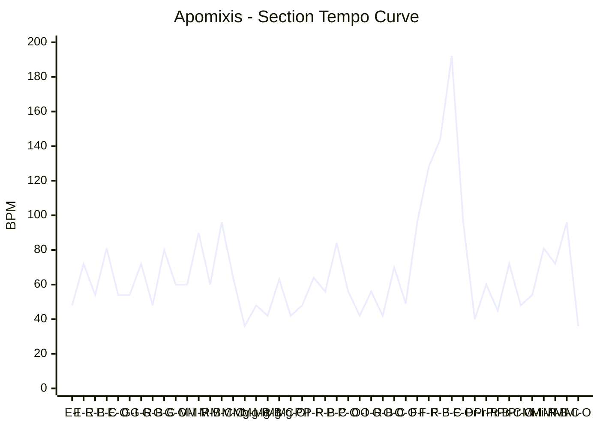

# Apomixis Macroform Graph

This graph is the first global tempo blueprint for the cycle. It uses one tempo node per formal section, for a total of `45` section-tempo nodes across `46:00`.

## Section Codes

- `I` = Introduction
- `R` = Replication
- `B` = Bridge
- `C` = Climax
- `O` = Coda

## Regime and Layer Legend

- `AUTO` = fully automata-driven piece
- `ANTH I` = voice + ornamental pitch-following
- `ANTH II` = guided improvisation through all sections
- `ANTH III` = 50/50 windows of improvisation and system generation
- `ANTH IV` = no more than three punctual human events
- `GO` = Grand Orgue
- `PO` = Positif
- `RE` = Recit
- `SO` = Solo
- `PE` = Pedale

## Macroform Timeline

```mermaid
gantt
    title Apomixis - Macroform and Tempo Blueprint
    dateFormat X
    axisFormat %M:%S

    section 1. Esporo / La planta | AUTO | GO+PO+PE
    Introduction · 48 BPM · GO+PO+PE :1.1, 0, 48s
    Replication · 72 BPM · GO+PO+PE :1.2, 48, 102s
    Bridge · 54 BPM · GO+PO+PE :1.3, 150, 42s
    Climax · 81 BPM · GO+PO+PE :1.4, 192, 66s
    Coda · 54 BPM · GO+PO+PE :1.5, 258, 42s

    section 2. Gameto / El grano | AUTO | PO+RE
    Introduction · 54 BPM · PO+RE :2.1, 300, 43s
    Replication · 72 BPM · PO+RE :2.2, 343, 92s
    Bridge · 48 BPM · PO+RE :2.3, 435, 38s
    Climax · 80 BPM · PO+RE :2.4, 473, 59s
    Coda · 60 BPM · PO+RE :2.5, 532, 38s

    section 3. Meiosis / Flor | ANTH III | GO+RE+PE
    Introduction · 60 BPM · GO+RE+PE :3.1, 570, 53s
    Replication · 90 BPM · GO+RE+PE :3.2, 623, 112s
    Bridge · 60 BPM · GO+RE+PE :3.3, 735, 46s
    Climax · 96 BPM · GO+RE+PE :3.4, 781, 73s
    Coda · 64 BPM · GO+RE+PE :3.5, 854, 46s

    section 4. Megaspora / Espora | AUTO | PO+RE+PE
    Introduction · 36 BPM · PO+RE+PE :4.1, 900, 73s
    Replication · 48 BPM · GO+PO+RE+PE :4.2, 973, 117s
    Bridge · 42 BPM · RE+SO+PE :4.3, 1090, 65s
    Climax · 63 BPM · GO+PO+RE+SO+PE :4.4, 1155, 77s
    Coda · 42 BPM · PO+RE+PE :4.5, 1232, 73s

    section 5. Polygonum / Embryo sac | ANTH II | PO+RE+SO
    Introduction · 48 BPM · PO+RE+SO :5.1, 1305, 53s
    Replication · 64 BPM · PO+RE+SO :5.2, 1358, 112s
    Bridge · 56 BPM · PO+RE+SO :5.3, 1470, 46s
    Climax · 84 BPM · PO+RE+SO :5.4, 1516, 73s
    Coda · 56 BPM · PO+RE+SO :5.5, 1589, 46s

    section 6. Oosfera | ANTH IV | RE+SO+PE
    Introduction · 42 BPM · RE+SO+PE :6.1, 1635, 43s
    Replication · 56 BPM · RE+SO+PE :6.2, 1678, 92s
    Bridge · 42 BPM · RE+SO+PE :6.3, 1770, 38s
    Climax · 70 BPM · RE+SO+PE :6.4, 1808, 59s
    Coda · 49 BPM · RE+SO+PE :6.5, 1867, 38s

    section 7. Filotaxis | AUTO | FULL TUTTI
    Introduction · 96 BPM · GO+RE+PE :7.1, 1905, 29s
    Replication · 128 BPM · GO+PO+RE+SO+PE :7.2, 1934, 72s
    Bridge · 144 BPM · GO+PO+RE+PE :7.3, 2006, 24s
    Climax · 192 BPM · GO+PO+RE+SO+PE :7.4, 2030, 79s
    Coda · 96 BPM · GO+RE+PE :7.5, 2109, 36s

    section 8. Proto-espora | AUTO | PO+SO+PE
    Introduction · 40 BPM · PO+SO+PE :8.1, 2145, 46s
    Replication · 60 BPM · PO+SO+PE :8.2, 2191, 97s
    Bridge · 45 BPM · PO+SO+PE :8.3, 2288, 40s
    Climax · 72 BPM · PO+SO+PE :8.4, 2328, 63s
    Coda · 48 BPM · PO+SO+PE :8.5, 2391, 40s

    section 9. Microspora / Pollen grain | ANTH I | PO+RE+SO+PE
    Introduction · 54 BPM · PO+PE :9.1, 2431, 43s
    Replication · 81 BPM · PO+RE+SO+PE :9.2, 2474, 102s
    Bridge · 72 BPM · PO+RE+PE :9.3, 2576, 59s
    Climax · 96 BPM · PO+RE+SO+PE :9.4, 2635, 76s
    Coda · 36 BPM · RE+PE :9.5, 2711, 50s
```

## Scenic Overlay

```mermaid
flowchart LR
    E["1. Esporo\nAUTO\nLayers: GO+PO+PE\nLights: cool low hall"]:::auto
    G["2. Gameto\nAUTO\nLayers: PO+RE\nLights: suspended neutral chamber"]:::auto
    M["3. Meiosis\nANTH III\nLayers: GO+RE+PE\nLights: warm lift in intervention windows"]:::anthro
    MG["4. Megaspora\nAUTO\nLayers: PO+RE+PE\nLights: near-dark dream breathing"]:::dream
    P["5. Polygonum\nANTH II\nLayers: PO+RE+SO\nLights: warm chamber / guided impro"]:::anthro
    O["6. Oosfera\nANTH IV\nLayers: RE+SO+PE\nLights: punctual wake pulses"]:::anthroLite
    F["7. Filotaxis\nAUTO\nLayers: FULL TUTTI\nLights: sharp white geometry"]:::tutti
    PR["8. Proto-espora\nAUTO\nLayers: PO+SO+PE\nLights: dormant dusk field"]:::auto
    MI["9. Microspora\nANTH I\nLayers: PO+RE+SO+PE\nLights: warm vocal halo to extinction"]:::finalAnthro

    E --> G --> M --> MG --> P --> O --> F --> PR --> MI

    classDef auto fill:#a8bfd1,stroke:#415a6b,color:#111;
    classDef anthro fill:#d7b07d,stroke:#7a5530,color:#111;
    classDef anthroLite fill:#d9c9a7,stroke:#8a7856,color:#111;
    classDef dream fill:#7f8fa9,stroke:#425066,color:#fff;
    classDef tutti fill:#f0a35b,stroke:#8b3f00,color:#111;
    classDef finalAnthro fill:#8e5d57,stroke:#402522,color:#fff;
```

## Tempo Curve

## Anthropomixis and Lighting Table

| Piece | Regime | Dominant layers | Main human marker | Main light cue |
|---|---|---|---|---|
| 1. Esporo / La planta | AUTO | GO+PO+PE | none | cool low side light, hall mostly in shadow |
| 2. Gameto / El grano | AUTO | PO+RE | none | suspended neutral chamber |
| 3. Meiosis / Flor | ANTH III | GO+RE+PE | 50/50 improvisation windows | warm lift only during human entry windows |
| 4. Megaspora / Espora | AUTO | PO+RE+PE | none | near-darkness, very slow breathing dimmer |
| 5. Polygonum / Embryo sac | ANTH II | PO+RE+SO | guided improvisation through all sections | warm chamber with visible bodily presence |
| 6. Oosfera | ANTH IV | RE+SO+PE | three punctual human events | brief structural light activations |
| 7. Filotaxis | AUTO | FULL TUTTI | none | brighter, harder, geometric light |
| 8. Proto-espora | AUTO | PO+SO+PE | none | dormant dusk field |
| 9. Microspora / Pollen grain | ANTH I | PO+RE+SO+PE | voice + ornamental pitch-following | warm narrow halo around console/vocal source, final near-blackout |

## Tempo Nodes Table

| Piece | Section | Start | End | BPM | Relation |
|---|---|---:|---:|---:|---|
| 1. Esporo / La planta | Introduction | 00:00 | 00:48 | 48 | seed pulse |
| 1. Esporo / La planta | Replication | 00:48 | 02:30 | 72 | 3:2 expansion |
| 1. Esporo / La planta | Bridge | 02:30 | 03:12 | 54 | 3:4 contraction |
| 1. Esporo / La planta | Climax | 03:12 | 04:18 | 81 | 3:2 expansion |
| 1. Esporo / La planta | Coda | 04:18 | 05:00 | 54 | 2:3 settling |
| 2. Gameto / El grano | Introduction | 05:00 | 05:43 | 54 | piece reset |
| 2. Gameto / El grano | Replication | 05:43 | 07:15 | 72 | 4:3 lift |
| 2. Gameto / El grano | Bridge | 07:15 | 07:53 | 48 | 2:3 suspension |
| 2. Gameto / El grano | Climax | 07:53 | 08:52 | 80 | 5:3 release |
| 2. Gameto / El grano | Coda | 08:52 | 09:30 | 60 | 3:4 settling |
| 3. Meiosis / Flor | Introduction | 09:30 | 10:23 | 60 | piece reset |
| 3. Meiosis / Flor | Replication | 10:23 | 12:15 | 90 | 3:2 duplication |
| 3. Meiosis / Flor | Bridge | 12:15 | 13:01 | 60 | 2:3 return |
| 3. Meiosis / Flor | Climax | 13:01 | 14:14 | 96 | 8:5 pressure |
| 3. Meiosis / Flor | Coda | 14:14 | 15:00 | 64 | 2:3 release |
| 4. Megaspora / Espora | Introduction | 15:00 | 16:13 | 36 | piece reset |
| 4. Megaspora / Espora | Replication | 16:13 | 18:10 | 48 | 4:3 germination |
| 4. Megaspora / Espora | Bridge | 18:10 | 19:15 | 42 | 7:8 drift |
| 4. Megaspora / Espora | Climax | 19:15 | 20:32 | 63 | 3:2 dilation |
| 4. Megaspora / Espora | Coda | 20:32 | 21:45 | 42 | 2:3 settling |
| 5. Polygonum / Embryo sac | Introduction | 21:45 | 22:38 | 48 | piece reset |
| 5. Polygonum / Embryo sac | Replication | 22:38 | 24:30 | 64 | 4:3 opening |
| 5. Polygonum / Embryo sac | Bridge | 24:30 | 25:16 | 56 | 7:8 chambering |
| 5. Polygonum / Embryo sac | Climax | 25:16 | 26:29 | 84 | 3:2 expansion |
| 5. Polygonum / Embryo sac | Coda | 26:29 | 27:15 | 56 | 2:3 withdrawal |
| 6. Oosfera | Introduction | 27:15 | 27:58 | 42 | piece reset |
| 6. Oosfera | Replication | 27:58 | 29:30 | 56 | 4:3 activation |
| 6. Oosfera | Bridge | 29:30 | 30:08 | 42 | 3:4 hollowing |
| 6. Oosfera | Climax | 30:08 | 31:07 | 70 | 5:3 ignition |
| 6. Oosfera | Coda | 31:07 | 31:45 | 49 | 7:10 seal |
| 7. Filotaxis | Introduction | 31:45 | 32:14 | 96 | piece reset |
| 7. Filotaxis | Replication | 32:14 | 33:26 | 128 | 4:3 packing |
| 7. Filotaxis | Bridge | 33:26 | 33:50 | 144 | 9:8 tightening |
| 7. Filotaxis | Climax | 33:50 | 35:09 | 192 | 4:3 overload |
| 7. Filotaxis | Coda | 35:09 | 35:45 | 96 | 1:2 cutback |
| 8. Proto-espora | Introduction | 35:45 | 36:31 | 40 | piece reset |
| 8. Proto-espora | Replication | 36:31 | 38:08 | 60 | 3:2 activation |
| 8. Proto-espora | Bridge | 38:08 | 38:47 | 45 | 3:4 cooling |
| 8. Proto-espora | Climax | 38:47 | 39:50 | 72 | 8:5 bloom |
| 8. Proto-espora | Coda | 39:50 | 40:30 | 48 | 2:3 residue |
| 9. Microspora / Pollen grain | Introduction | 40:30 | 41:13 | 54 | piece reset |
| 9. Microspora / Pollen grain | Replication | 41:13 | 42:55 | 81 | 3:2 vocal uptake |
| 9. Microspora / Pollen grain | Bridge | 42:55 | 43:55 | 72 | 8:9 shadowing |
| 9. Microspora / Pollen grain | Climax | 43:55 | 45:10 | 96 | 4:3 pressure |
| 9. Microspora / Pollen grain | Coda | 45:10 | 46:00 | 36 | 3:8 extinction halo |
